

  

<h3 align="center">Traduções de jogos em português do Brasil, instaladas com um clique.</h3>

  
  &nbsp;
  
  &nbsp;
  

<b>Gratuito, feito por fã, sem anúncios.</b> Windows 10 ou 11.

> [!NOTE]
> **O N7Traduções agora é Relay.** Mesmo autor, as mesmas traduções gratuitas e um programa novo, do zero.
> Já usa o N7Traduções? É só instalar o Relay: as traduções que você já instalou e as suas configurações continuam.

---

## ✨ O que é o Relay

O Relay é o programa que coloca as traduções nos seus jogos. Você escolhe o jogo, clica em **Instalar** e ele faz o resto: baixa a tradução, confere se os arquivos chegaram inteiros, guarda uma cópia dos arquivos originais e instala. Se algo der errado no meio do caminho, ele desfaz tudo e avisa. E quando quiser o jogo como era antes, é só clicar em **Restaurar originais**.

  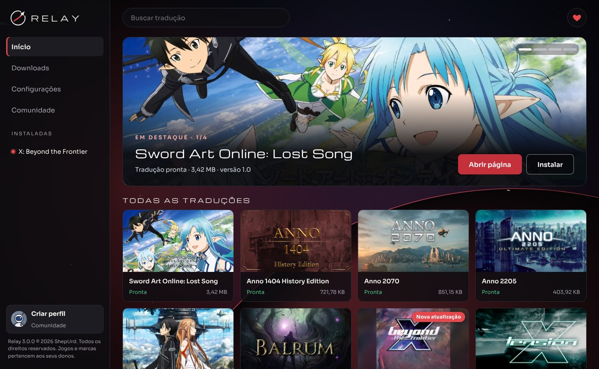

## 🆕 Novidades da versão 3.0

| Novidade | O que mudou |
|---|---|
| 🎨 **Cara nova** | Visual todo refeito, com destaques, capas grandes, tema escuro e claro e uma abertura animada. |
| 🎮 **4 traduções novas** | Sword Art Online: Lost Song, Anno 1404 History Edition, Anno 2070 e Anno 2205. |
| 📄 **Página de cada tradução** | Abas **Sobre**, **Novidades**, **Avaliações** e **Instalação manual**. |
| ⏸️ **Downloads melhores** | Dá para pausar e continuar, e o download retoma sozinho se a internet cair. |
| 🔔 **Aviso de nova atualização** | Quando sai uma versão nova de uma tradução que você instalou, o card dela avisa. |
| 💬 **Comunidade** | Perfil, pedidos de tradução, relatos de problemas, ajuda, avaliações e níveis com recompensas. |
| 🔄 **Atualiza sozinho** | O Relay baixa e instala as próprias versões novas, conferidas por assinatura digital. |
| 👋 **Boas-vindas** | Na primeira abertura, uma tela rápida explica como tudo funciona. |

## 🧰 Facilidades

- **Um clique.** Em vários jogos o Relay acha a pasta sozinho; quando não acha, pede a pasta uma vez e lembra dela.
- **Seguro.** Cada download é conferido antes de mexer no jogo, e um pacote de tradução nunca instala programas, bibliotecas ou scripts no jogo.
- **Reversível.** Os arquivos originais ficam guardados, e **Restaurar originais** devolve o jogo como era.
- **Sem surpresas.** Antes de instalar, o Relay mostra o espaço que a tradução e a cópia dos originais precisam, e você escolhe se quer a cópia.
- **Sem administrador.** O instalador do Relay não pede permissão de administrador.

---

## ⬇️ Baixar e instalar o Relay

1. Baixe o **[Setup_Relay.exe](https://github.com/DeadShepurd/Traducoes/releases/download/relay-v3.0.0/Setup_Relay.exe)**.
2. Abra o arquivo e siga o instalador.
3. Abra o **Relay** pelo menu Iniciar.

> [!TIP]
> Se o Windows mostrar **"O Windows protegeu o computador"**, clique em **Mais informações** e depois em **Executar assim mesmo**. Isso acontece com programas novos que ainda não são conhecidos pelo Windows. Baixe o Relay **só daqui**, e não desative o antivírus.

---

## 🧭 Conheça o Relay

### Abertura

A logo animada aparece enquanto o catálogo de traduções carrega. Dá para pular com um clique, e a música da abertura pode ser desligada em Configurações.

### Boas-vindas

Na primeira vez que você abre o Relay, uma tela rápida explica como ele funciona. Dá para ver de novo quando quiser em **Configurações**.

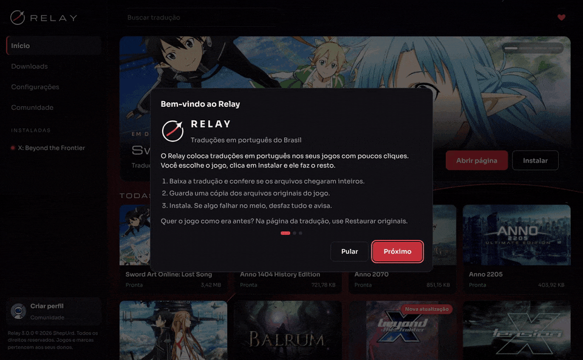

### Início

Todas as traduções num lugar só. No alto ficam os **destaques** (use as setas para passar), embaixo os **cards** de cada jogo. A busca filtra enquanto você digita.

### Página da tradução

Clique num card para abrir a página do jogo: tamanho, versão, botões de **Instalar** e **Restaurar originais**, e as abas **Sobre**, **Novidades**, **Avaliações** e **Instalação manual**.

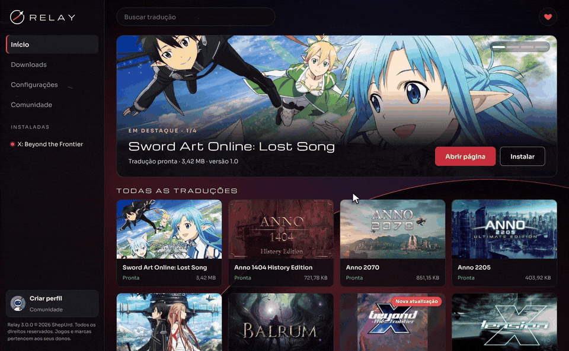

### Instalar uma tradução

Clique em **Instalar**. Se o Relay pedir a pasta do jogo, escolha a pasta principal dele. A instalação aparece em **Downloads**, em três etapas: **baixar**, **verificar** e **guardar originais e instalar**. O download pode ser pausado e continuado.

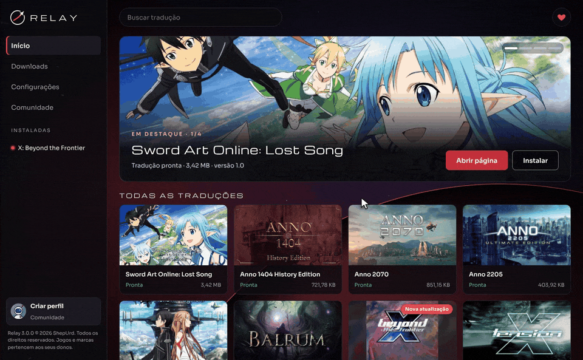

> [!TIP]
> Não sabe onde o jogo está? Na Steam, clique com o botão direito no jogo → **Gerenciar** → **Ver arquivos locais**. Essa é a pasta que o Relay pede.

### Nova atualização de uma tradução

Quando sai uma versão nova de uma tradução que você já instalou, o card mostra **Nova atualização** e a página da tradução troca o botão para **Atualizar tradução**. O que mudou fica na aba **Novidades**.

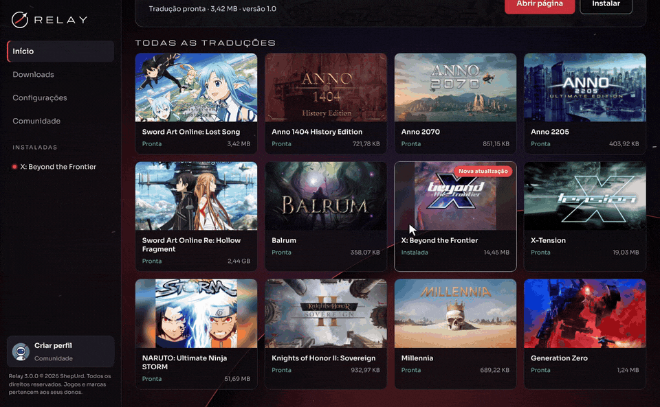

### Restaurar originais

As traduções instaladas aparecem em **Instaladas**, na barra ao lado. Na página da tradução, **Restaurar originais** devolve os arquivos do jogo como eram antes.

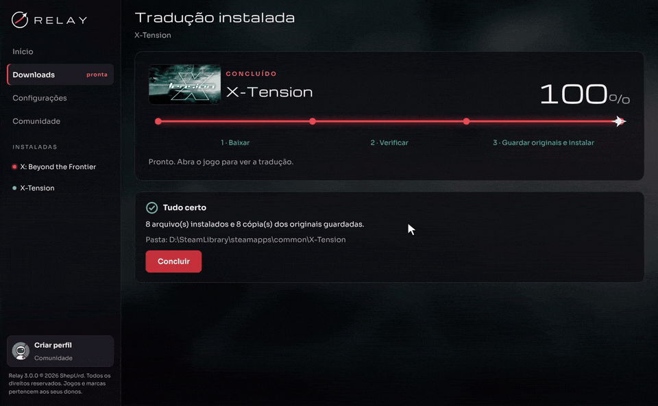

### Comunidade

Peça traduções, vote nos pedidos dos outros, relate problemas e tire dúvidas. Para escrever, crie um perfil (é rápido); para ler, nem precisa.

### Configurações

Tema escuro ou claro, animações, música da abertura, atualização automática do Relay e relatórios de erro.

> [!NOTE]
> **Relatórios de erro:** se uma instalação falhar, o Relay pode enviar um relatório técnico para o erro ser corrigido. Ele **nunca** leva seu nome, e-mail, usuário do Windows, saves ou arquivos do jogo, e nada é enviado quando a instalação dá certo. Dá para desligar em Configurações.

---

## 🎮 Traduções disponíveis

<table>
  <tr>
    <td width="33%" align="center" valign="top"><a href="#sword-art-online-lost-song">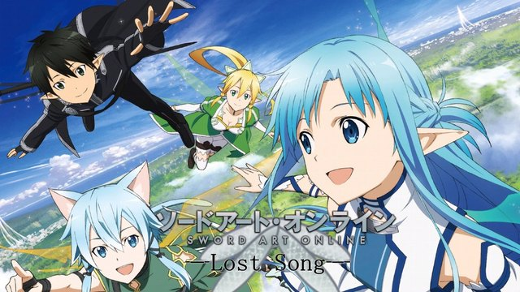</a> <b>Sword Art Online: Lost Song</b> 🆕 Nova</td>
    <td width="33%" align="center" valign="top"><a href="#anno-1404-history-edition">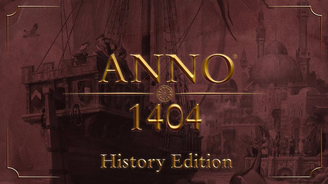</a> <b>Anno 1404 History Edition</b> 🆕 Nova</td>
    <td width="33%" align="center" valign="top"><a href="#anno-2070">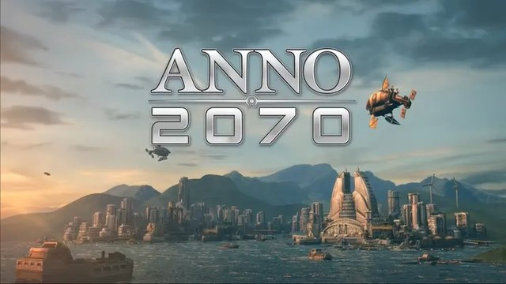</a> <b>Anno 2070</b> 🆕 Nova</td>
  </tr>
  <tr>
    <td align="center" valign="top"><a href="#anno-2205">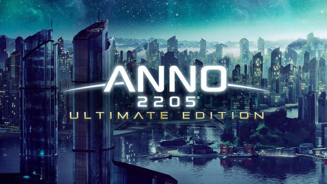</a> <b>Anno 2205</b> 🆕 Nova</td>
    <td align="center" valign="top"><a href="#sword-art-online-re-hollow-fragment">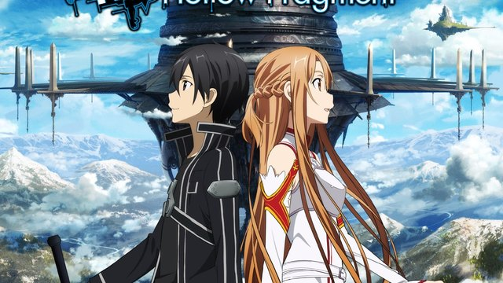</a> <b>Sword Art Online Re: Hollow Fragment</b> ✅ Pronta</td>
    <td align="center" valign="top"><a href="#balrum">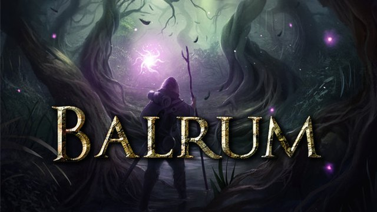</a> <b>Balrum</b> ✅ Pronta</td>
  </tr>
  <tr>
    <td align="center" valign="top"><a href="#x-beyond-the-frontier">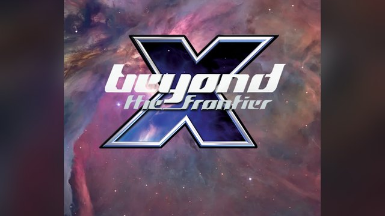</a> <b>X: Beyond the Frontier</b> ✅ Pronta</td>
    <td align="center" valign="top"> <b>X-Tension</b> ✅ Pronta</td>
    <td align="center" valign="top"><a href="#naruto-ultimate-ninja-storm">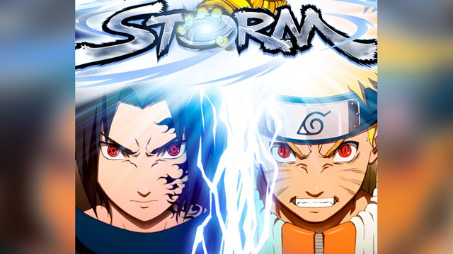</a> <b>NARUTO: Ultimate Ninja STORM</b> ✅ Pronta</td>
  </tr>
  <tr>
    <td align="center" valign="top"><a href="#knights-of-honor-ii-sovereign">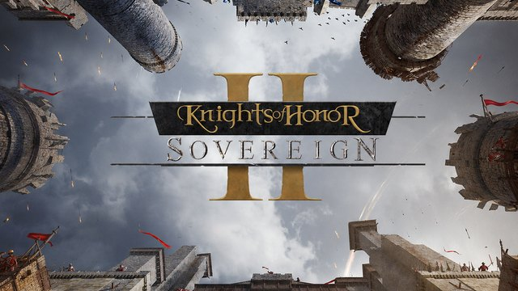</a> <b>Knights of Honor II: Sovereign</b> ✅ Pronta</td>
    <td align="center" valign="top"><a href="#millennia">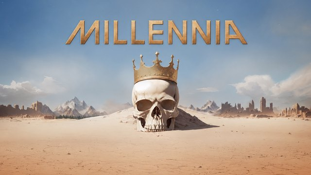</a> <b>Millennia</b> ✅ Pronta</td>
    <td align="center" valign="top"><a href="#generation-zero">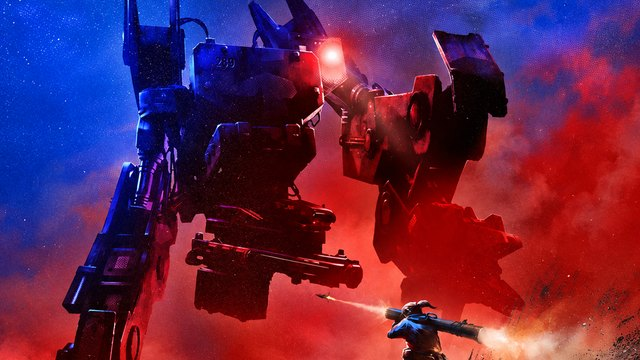</a> <b>Generation Zero</b> ✅ Pronta</td>
  </tr>
</table>

As traduções são dos **textos** dos jogos (não há dublagem). Elas foram feitas numa versão específica de cada jogo: quando o jogo recebe uma atualização grande, a tradução pode precisar de uma versão nova.

 

### Sword Art Online: Lost Song

<table>
<tr>
<td width="40%" valign="top"></td>
<td valign="top">

Textos do jogo, legendas dos vídeos e textos desenhados nas imagens em português do Brasil.

**Pelo Relay:** clique em **Instalar**. O Relay procura o jogo sozinho; se pedir, escolha a pasta que tem o `SAOLS.exe`. Depois, abra o jogo normalmente com o idioma em **English**.

**Instalação manual:** não tem. A tradução é aplicada dentro dos pacotes do jogo, e quem faz isso com segurança (e desfaz depois) é o Relay.

</td>
</tr>
</table>

### Anno 1404 History Edition

<table>
<tr>
<td width="40%" valign="top"></td>
<td valign="top">

Textos do jogo em português do Brasil.

**Pelo Relay:** clique em **Instalar**. Se o Relay pedir, escolha a pasta do jogo (a que tem as pastas `maindata` e `addon`). Ele confere se o seu jogo é a mesma versão usada na tradução, monta a tradução a partir do próprio jogo e guarda o original. Depois, abra o jogo normalmente com o idioma em **English**.

**Instalação manual:** não tem. A tradução é montada no seu computador, dentro de uma cópia de um pacote do próprio jogo, então só dá para instalar pelo Relay.

</td>
</tr>
</table>

### Anno 2070

<table>
<tr>
<td width="40%" valign="top"></td>
<td valign="top">

Textos do jogo em português do Brasil.

**Pelo Relay:** clique em **Instalar**. Se o Relay pedir, escolha a pasta do jogo (a que tem a pasta `maindata`). Ele confere se o seu jogo é a mesma versão usada na tradução, monta a tradução a partir do próprio jogo e guarda o original. Depois, abra o jogo normalmente com o idioma em **English**.

**Instalação manual:** não tem, pelo mesmo motivo do Anno 1404.

</td>
</tr>
</table>

### Anno 2205

<table>
<tr>
<td width="40%" valign="top"></td>
<td valign="top">

Textos do jogo em português do Brasil. Os pacotes do jogo **não são alterados**: a tradução é um arquivo de textos que o jogo lê da pasta dele.

**Pelo Relay:** antes, abra o Anno 2205 uma vez e feche (é quando o jogo cria as configurações dele). Depois, clique em **Instalar** e, se o Relay pedir, escolha a pasta do jogo (a que tem a pasta `maindata`). O Relay põe o arquivo de textos na pasta do jogo e liga a opção `PreferLocalFiles` no `engine.ini`. **Restaurar originais** desfaz as duas coisas.

**Instalação manual:**
1. Extraia o `anno2205.zip`.
2. Copie a pasta `data` (que está dentro de `textos`) para a pasta do jogo, ao lado da `maindata`.
3. Abra `Documentos\Anno 2205\config\engine.ini` no Bloco de Notas e troque `"PreferLocalFiles": false` por `"PreferLocalFiles": true`.

Para desfazer: apague a pasta `data` que você copiou e volte a opção para `false`.

</td>
</tr>
</table>

### Sword Art Online Re: Hollow Fragment

<table>
<tr>
<td width="40%" valign="top"></td>
<td valign="top">

Textos, história, menus e legendas das cenas traduzidos.

**Pelo Relay:** clique em **Instalar** e escolha a pasta principal do jogo (a que tem o `SAOHF.exe`). A tradução vem em duas partes, e o Relay baixa e instala as duas em sequência.

**Instalação manual:** baixe as duas partes na [página da tradução](https://github.com/DeadShepurd/Traducoes/releases/tag/sao-re-hf-v1.0) e extraia primeiro a `fragment_parte1.zip` e depois a `fragment_parte2.zip` na pasta principal do jogo, substituindo os arquivos. Antes, guarde uma cópia dos arquivos que serão substituídos.

</td>
</tr>
</table>

### Balrum

<table>
<tr>
<td width="40%" valign="top"></td>
<td valign="top">

Textos do jogo traduzidos.

**Pelo Relay:** clique em **Instalar** e escolha a pasta principal do jogo.

**Instalação manual:** baixe o `br.zip` na [página da tradução](https://github.com/DeadShepurd/Traducoes/releases/tag/balrum-v1.0) e extraia. Dentro da pasta do jogo, ache a pasta `en` com os textos em inglês e copie a pasta `en` do ZIP por cima dela, substituindo os arquivos. Antes, guarde uma cópia da pasta `en` original.

</td>
</tr>
</table>

### X: Beyond the Frontier

<table>
<tr>
<td width="40%" valign="top"></td>
<td valign="top">

Interface, HUD, comércio, banco de dados e campanha traduzidos. O texto fica sem acentos por causa do limite da fonte do jogo.

**Pelo Relay:** clique em **Instalar** e escolha a pasta principal do jogo.

**Instalação manual:** baixe o ZIP na [página da tradução](https://github.com/DeadShepurd/Traducoes/releases/tag/x-btf-v1.0) e extraia os arquivos `01.cat` e `01.dat` na pasta principal do jogo, substituindo os originais (guarde uma cópia deles antes).

</td>
</tr>
</table>

### X-Tension

<table>
<tr>
<td width="40%" valign="top"></td>
<td valign="top">

Tradução com abreviações para caber na interface. O texto fica sem acentos por causa do limite da fonte do jogo.

**Pelo Relay:** clique em **Instalar** e escolha a pasta principal do jogo.

**Instalação manual:** baixe o ZIP na [página da tradução](https://github.com/DeadShepurd/Traducoes/releases/tag/x-tension-v1.0) e extraia os arquivos `01.cat` e `01.dat` na pasta principal do jogo, substituindo os originais (guarde uma cópia deles antes).

</td>
</tr>
</table>

### NARUTO: Ultimate Ninja STORM

<table>
<tr>
<td width="40%" valign="top"></td>
<td valign="top">

Edição final em português do Brasil: sistema, missões, batalhas, itens, tutoriais, menus e coleção, com as artes de interface refeitas.

**Pelo Relay:** feche o jogo, clique em **Instalar** e escolha a pasta principal do jogo. O Relay confere o arquivo original e reconstrói o `dataRegion.cpk` com a tradução, em 152 etapas. Não interrompa no meio.

**Instalação manual:** baixe o `Storm.zip` na [página da tradução](https://github.com/DeadShepurd/Traducoes/releases/tag/Storm), extraia numa pasta e copie para ela o `dataRegion.cpk` original do jogo (fica em `data\disc`). Rode o `INSTALAR_PTBR_FINAL.bat`: ele cria o `dataRegion_PTBR_FINAL.cpk`. Guarde o original e coloque o arquivo novo no lugar dele, com o nome `dataRegion.cpk`. O `LEIA-ME_FINAL.txt` dentro do ZIP explica cada passo.

</td>
</tr>
</table>

### Knights of Honor II: Sovereign

<table>
<tr>
<td width="40%" valign="top"></td>
<td valign="top">

Tradução completa para português do Brasil, instalada como um mod do jogo.

**Pelo Relay:** clique em **Instalar**. A tradução vira o mod `N7_KOH2_PTBR`, separado dos seus outros mods. Depois, no jogo: entre em **Mods** e ative `N7_KOH2_PTBR`; em **Settings → Text Languages**, escolha **Português (Brasil)** e reinicie o jogo se ele pedir. Para tirar a tradução, o botão **Desativar tradução** desliga só esse mod.

**Instalação manual:** baixe o `koh2.zip` na [página da tradução](https://github.com/DeadShepurd/Traducoes/releases/tag/koh2-v1.0) e extraia em `%USERPROFILE%\AppData\LocalLow\BlackSeaGames\Sovereign\Mods` (fica a pasta `Mods\N7_KOH2_PTBR`). Depois, ative no jogo como explicado acima.

</td>
</tr>
</table>

### Millennia

<table>
<tr>
<td width="40%" valign="top"></td>
<td valign="top">

Tradução completa para português do Brasil, com 14.288 textos, instalada como um mod local. Os arquivos originais do jogo não são modificados.

**Pelo Relay:** clique em **Instalar**. A tradução vira o mod `N7-Millennia`. Depois, abra o jogo com o idioma de texto em **English**: o mod é carregado sozinho. Para tirar a tradução, o botão **Desativar tradução** desliga só esse mod.

**Instalação manual:** baixe o `millennia.zip` na [página da tradução](https://github.com/DeadShepurd/Traducoes/releases/tag/millennia-v1.0) e extraia em `%USERPROFILE%\AppData\LocalLow\CPromptGames\Millennia\Mods` (fica a pasta `Mods\N7-Millennia`).

</td>
</tr>
</table>

### Generation Zero

<table>
<tr>
<td width="40%" valign="top"></td>
<td valign="top">

Textos do jogo traduzidos para português do Brasil.

**Pelo Relay:** feche o jogo e clique em **Instalar**. O Relay acha o jogo na Steam sozinho (se houver mais de uma instalação, escolha a pasta que tem o `GenerationZero_F.exe`). A preparação pode demorar e precisa de espaço livre. Depois, abra o jogo normalmente com o idioma em **English**. Os áudios continuam os originais.

**Instalação manual:** não tem. A tradução é aplicada dentro dos arquivos de recursos do jogo (TAB/ARC), e extrair o ZIP na pasta do jogo não funciona.

</td>
</tr>
</table>

---

## ❓ Dúvidas comuns

**O jogo continua em inglês depois de instalar.**
Confira se o idioma do jogo está em **English** (é esse que a tradução substitui). Se o jogo recebeu uma atualização depois da instalação, abra o Relay e instale de novo.

**O jogo atualizou e a tradução sumiu.**
Atualizações do jogo podem trocar os arquivos. Abra o Relay e instale de novo. Se o Relay avisar que a versão do jogo é diferente da usada na tradução, relate pelo link abaixo.

**Quero desinstalar a tradução.**
Abra a tradução no Relay e clique em **Restaurar originais** (nos jogos com mod, **Desativar tradução**). Use com o jogo fechado.

**Onde ficam os arquivos para download?**
Na página de [Releases](https://github.com/DeadShepurd/Traducoes/releases). Baixe o arquivo anexado de cada versão; os itens **Source code (zip)** e **Source code (tar.gz)** não são o Relay nem as traduções.

## 📝 Pedidos e problemas

- Pelo Relay: aba **Comunidade**.
- Pelo GitHub: [pedir uma tradução](https://github.com/DeadShepurd/Traducoes/issues/new?template=pedido-de-traducao.yml) · [relatar um problema](https://github.com/DeadShepurd/Traducoes/issues/new?template=relatar-problema.yml)

Ao relatar, diga o jogo, a versão do Relay, a versão da tradução e a mensagem de erro completa. Para erro de texto, mande uma captura de tela mostrando onde a frase aparece. Esconda informações pessoais dos caminhos e das capturas antes de publicar.

## ❤️ Apoiar

As traduções são e sempre serão gratuitas. Se elas te ajudaram e você quiser apoiar, qualquer valor é bem-vindo, mas é só se quiser. Obrigado!

**Ko-fi:** https://ko-fi.com/shepurd · **Pix:** no botão ❤️ dentro do Relay

## ⚠️ Aviso

Projeto de fã, sem vínculo com as desenvolvedoras ou distribuidoras dos jogos. Jogos e marcas pertencem aos seus donos. As traduções não incluem os jogos: é preciso ter uma cópia original.

Relay © 2026 ShepUrd

