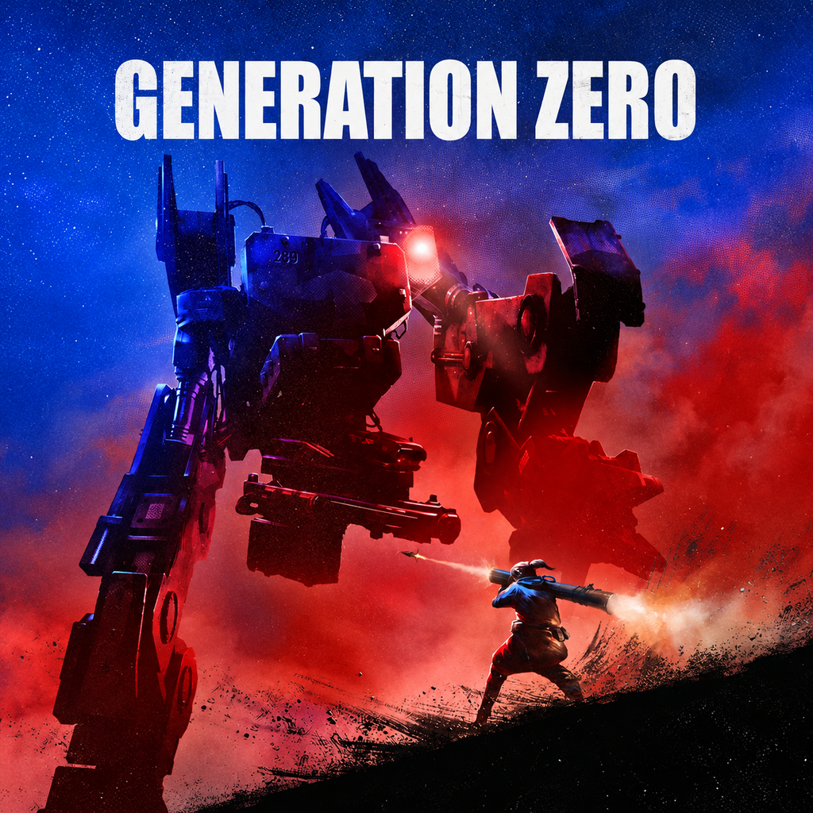

[README.md](https://github.com/user-attachments/files/34167393/README.md)
# 🎮 Traduções — ShepUrd

Traduções de fã para a comunidade brasileira, distribuídas gratuitamente pela **N7Traduções**.

## ⬇️ Como jogar em português

1. Baixe o [Setup_N7Traducoes.exe — v2.4.1](https://github.com/DeadShepurd/Traducoes/releases/download/app-v2.4.1/Setup_N7Traducoes.exe).
2. Instale e abra a **N7Traduções v2.4.1**. O catálogo e as capas são carregados automaticamente.
3. Feche o jogo, escolha a tradução e clique em **BAIXAR E INSTALAR**.
4. Aguarde o término. Se o programa pedir uma pasta, selecione a pasta principal do jogo, onde está o executável — não uma subpasta de arquivos.
5. Confira abaixo a orientação de idioma ou ativação específica do seu jogo.

Para o **Generation Zero**, use a v2.4.1 ou superior. Atualizar apenas o catálogo de uma versão antiga não adiciona o novo método de instalação ao programa.

> O Windows pode exibir um aviso de reputação ou de editor desconhecido. Baixe somente deste repositório e confirme a origem do arquivo antes de executá-lo. Não desative o antivírus para instalar a tradução. Se houver uma detecção, envie os detalhes pelo canal de problemas.

## 🕹️ Jogos disponíveis

| Jogo | Status | Progresso | Instalação |
|---|---|---:|---|
| Sword Art Online Re: Hollow Fragment | ✅ Disponível | 100% | Automática, em duas partes |
| Balrum | ✅ Disponível | 100% | Automática, na pasta do jogo |
| X: Beyond the Frontier | ✅ Disponível | 100% | Automática, na pasta do jogo |
| X-Tension | ✅ Disponível | 100% | Automática, na pasta do jogo |
| NARUTO: Ultimate Ninja STORM | ✅ Disponível | 100% | Automática, com reconstrução do `dataRegion.cpk` |
| Knights of Honor II: Sovereign | ✅ Disponível | 100% | Automática, como mod |
| Millennia | ✅ Disponível | 100% | Automática, como mod local no AppData |
| Generation Zero | ✅ Disponível | 100% | Automática, diretamente nos arquivos TAB/ARC |

O progresso se refere à tradução dos textos da edição trabalhada. Não significa dublagem em português nem garantia de compatibilidade com futuras atualizações do jogo.

## 🤖 Generation Zero

<p align="center">
  
</p>

**Tradução PT-BR v1.0 — por ShepUrd.**

A N7Traduções localiza a instalação Steam e aplica os textos diretamente nos arquivos de recursos TAB/ARC, criando backup dos originais. Não é necessário extrair arquivos manualmente, copiar uma pasta `dropzone` ou acrescentar comandos às opções de inicialização da Steam.

### Instalar

1. Feche o Generation Zero.
2. Abra a **N7Traduções v2.4.1 ou superior** e clique em **Atualizar catálogo**.
3. No cartão **Generation Zero**, clique em **BAIXAR E INSTALAR**.
4. Se houver mais de uma instalação ou a detecção não encontrar o jogo, indique a pasta que contém `GenerationZero_F.exe`.
5. Aguarde a mensagem de conclusão, sem interromper o programa. A criação do backup e a preparação dos arquivos podem levar tempo e precisam de espaço livre em disco.
6. Inicie o jogo normalmente, mantendo o idioma em **English**. A tradução substitui os textos desse idioma; os áudios permanecem os do jogo.

### Restaurar e atualizar

Feche o jogo e use **Restaurar original** na N7Traduções. Preserve a pasta `Backup Original` e os arquivos de controle criados pelo instalador.

Antes de atualizar o jogo ou trocar mods que alteram os mesmos recursos, restaure os originais. Se o instalador informar que os arquivos não correspondem à versão esperada, não force a instalação: relate o erro. A compatibilidade depende dos recursos da versão usada como base da tradução.

[Release da tradução — generationzero-v1.0](https://github.com/DeadShepurd/Traducoes/releases/tag/generationzero-v1.0)

O arquivo da tradução é `generationzero.zip`. Para o jogador, o caminho recomendado é o botão **BAIXAR E INSTALAR** da N7Traduções; extrair esse ZIP na pasta do jogo não aplica a tradução.

## 🛡️ Knights of Honor II: Sovereign

A tradução é instalada como o mod `N7_KOH2_PTBR`, separado dos outros jogos e mods.

Depois da instalação:

1. Abra **Knights of Honor II: Sovereign**.
2. Entre no menu **Mods** e ative `N7_KOH2_PTBR`.
3. Em **Settings → Text Languages**, selecione **Português (Brasil)**.
4. Aplique as alterações e reinicie o jogo se solicitado.

O mod fica em:

```text
%USERPROFILE%\AppData\LocalLow\BlackSeaGames\Sovereign\Mods\N7_KOH2_PTBR
```

**Restaurar original** desativa somente o mod da tradução. Outros mods permanecem intactos.

## 🏛️ Millennia

A tradução contém **14.288 textos em português do Brasil** e é instalada como o mod local `N7-Millennia`. O bundle, o catálogo Addressables e os demais arquivos originais do jogo não são modificados.

Depois da instalação:

1. Abra **Millennia**.
2. Mantenha o idioma de texto em **English**.
3. O jogo carregará automaticamente os textos em português fornecidos pelo mod.

O mod fica em:

```text
%USERPROFILE%\AppData\LocalLow\CPromptGames\Millennia\Mods\N7-Millennia
```

**Restaurar original** move somente `N7-Millennia` para a pasta `N7_Backups`. Outros mods e os arquivos originais permanecem intactos.

## 🍥 NARUTO: Ultimate Ninja STORM

A edição final PT-BR é instalada automaticamente. A ferramenta valida os arquivos originais e reconstrói o `dataRegion.cpk` em 152 etapas, permitindo aplicar textos maiores sem depender do espaço disponível no arquivo original.

Feche o jogo antes de instalar ou restaurar. Não interrompa a reconstrução.

## ⚔️ Sword Art Online Re: Hollow Fragment

A tradução usa dois pacotes: `fragment_parte1.zip` e `fragment_parte2.zip`. A N7Traduções baixa e instala ambos pelo mesmo botão. Aguarde a conclusão das duas partes; não é necessário baixá-las manualmente.

## ↩️ Backup e restauração

- Nos jogos que recebem arquivos diretamente, os originais são guardados em **Backup Original** antes da substituição.
- No Generation Zero, a restauração recupera os recursos TAB/ARC preservados pela instalação.
- Knights of Honor II e Millennia usam mods isolados; a restauração desativa somente a tradução correspondente.
- Use **Restaurar original** com o jogo fechado. Não apague os backups enquanto quiser manter essa possibilidade.
- Os backups da tradução não substituem uma cópia de segurança dos seus saves.

## 🔄 Catálogo e atualizações

Use **Atualizar catálogo** para buscar os jogos e pacotes publicados. Novos conteúdos que usam um método já suportado normalmente exigem apenas a atualização do catálogo; novos métodos podem exigir uma versão nova da N7Traduções.

- O aplicativo tem release própria: `app-v2.4.1` → `Setup_N7Traducoes.exe`.
- Knights of Honor II: `koh2-v1.0` → `koh2.zip`.
- Millennia: `millennia-v1.0` → `millennia.zip`.
- Generation Zero: `generationzero-v1.0` → `generationzero.zip`.

Na página de releases, baixe o arquivo anexado correspondente. Os arquivos automáticos **Source code (zip)** e **Source code (tar.gz)** não são o instalador nem o pacote da tradução.

## 📝 Pedidos e problemas

- [Pedir uma tradução](https://github.com/DeadShepurd/Traducoes/issues/new?template=pedido-de-traducao.yml)
- [Relatar um problema](https://github.com/DeadShepurd/Traducoes/issues/new?template=relatar-problema.yml)

Informe o jogo, a versão da N7Traduções, a versão da tradução e a mensagem completa do erro. Para erros de texto, inclua uma captura de tela e onde a frase aparece. Oculte informações pessoais dos caminhos e capturas antes de publicar.

## ❤️ Apoiar

Se as traduções te ajudaram, considere apoiar o trabalho. Qualquer valor é bem-vindo. Obrigado!

**Pix:** `eudedegoes1@gmail.com`

**Outras formas:** https://ko-fi.com/shepurd

## ⚠️ Aviso

Este é um projeto de fãs, sem vínculo oficial com as desenvolvedoras ou distribuidoras dos jogos. As traduções são gratuitas e não incluem os jogos; é necessário possuir uma cópia compatível.

---

_N7Traduções v2.4.1 — catálogo e instalação automática por ShepUrd._
